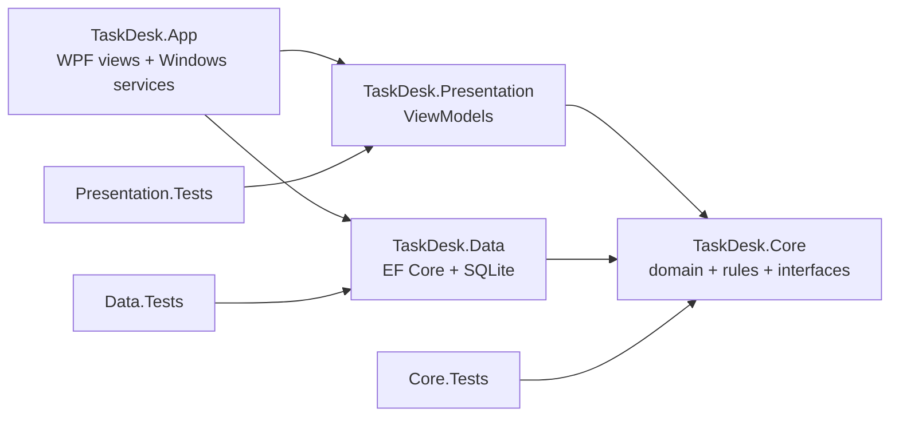
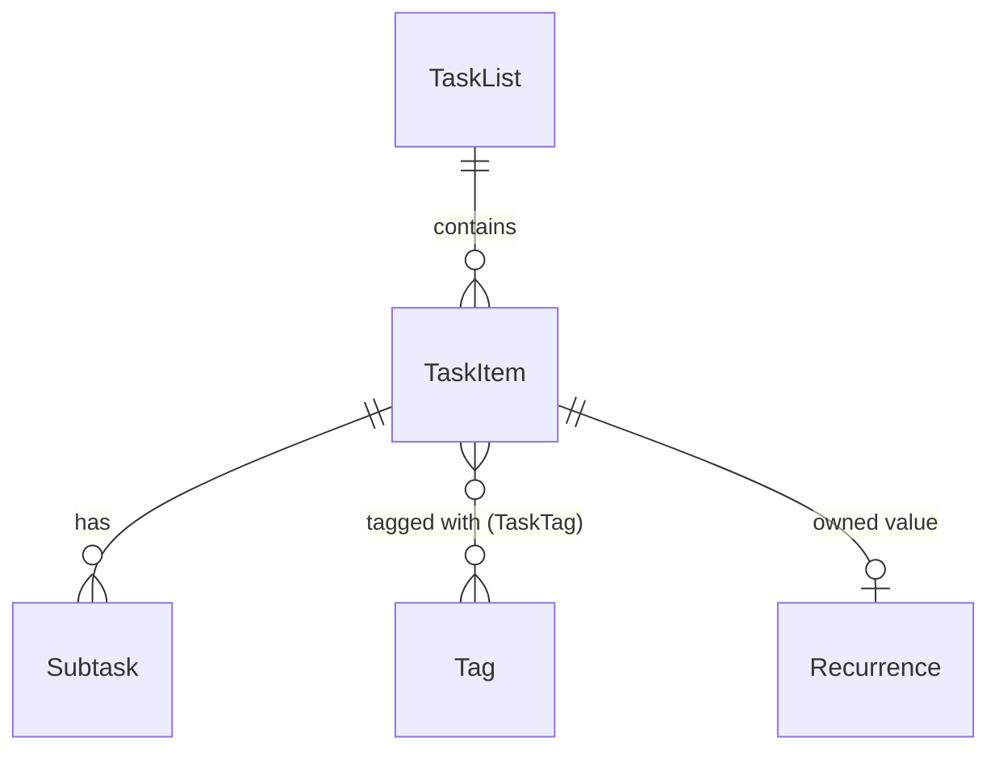

# TaskDesk — Implementation Specification

**Audience:** a fresh coding agent (Claude Code running on the owner's Windows 11 PC) implementing the whole application from an empty folder.
**Owner:** João (senior C#/C++ Windows developer). Single user, personal use.
**Status:** v1 spec, decisions agreed on 2026-10-16. Items marked **[ASSUMPTION]** were chosen by the spec author and may be changed by the owner; follow them unless told otherwise.

---

## 0. How to use this document (instructions to the agent)

1. Read the whole spec before writing code.
2. Work milestone by milestone (section 12). After each milestone: `dotnet build` with zero warnings and `dotnet test` all green, then **propose** a commit (branch, staged files, gate result, message) and wait for the owner's approval. The owner's global git rules (branch per plan, approval for every commit) take precedence over this document.
3. When something in this spec turns out to be technically wrong or impossible (library behavior changed, API missing), **stop and report it** with evidence (error message, doc link) and a proposed alternative. Do not silently substitute a different design.
4. Use the **latest stable** versions of the NuGet packages named here. Do not use preview packages unless a section says so explicitly.
5. Do not invent requirements. If behavior is unspecified and it matters, pick the simplest option and implement it. Record it as an ADR in `docs/adr/` (`NNNN-slug.md`) only when it is hard to reverse, surprising without context, and the result of a real trade-off; otherwise do not record it.
6. Use the vocabulary in `GLOSSARY.md` (Task, List, Default List, Smart View, Due, Overdue, Reminder, Snooze, Series, Occurrence, Skip, …) in code, tests and docs.
7. Keep the owner informed: at the end, produce `README.md` (build, run, publish, data location, known limitations) and `docs/MANUAL-TESTS.md` (section 11.3).

---

## 1. Product summary

TaskDesk is a small, fast, **local-only** to-do list desktop app for Windows 11. It lives in the system tray (the notification area icons near the clock), starts with Windows, and shows Windows notifications for reminders. It supports multiple lists, tags, priorities, due dates, subtasks, recurring tasks, search, light/dark theme, a global quick-add hotkey, and JSON/CSV export with JSON import.

### 1.1 Agreed decisions

| Topic | Decision |
|---|---|
| Data location | Local only, on this PC. No cloud, no sync, no JMTaskApi integration. |
| UI framework | WPF (Windows Presentation Foundation) on .NET 10 |
| Feature level | "Rich": lists, notes, due date, priority, search/filter, subtasks, tags, recurring tasks, reminders with Windows notifications |
| Packaging | Unpackaged (no MSIX), self-contained (.NET runtime included) folder you copy and run |
| Background behavior | Closing the window hides to tray; app auto-starts at Windows login |
| Storage | SQLite database through EF Core (Entity Framework Core, Microsoft's object-relational mapper) with migrations |
| Extras in scope | Light/dark theme, import/export, global quick-add hotkey |
| Extras out of scope | Localization (UI is English only) |
| Quality bar | Unit tests + integration tests; an opt-in UI test suite outside the gate (#23) |
| Recurrence | Common presets (section 5) — not full iCalendar RRULE |
| OS support | Windows 11 only (build 22000 or newer), x64 |
| Name | TaskDesk |

### 1.2 Explicitly out of scope for v1

Sync of any kind, JMTaskApi, accounts/login, mobile, multiple users, file attachments, rich-text notes, localization, MSIX/installer, auto-update, encryption at rest, ARM64 builds.

---

## 2. Technology stack

| Concern | Choice | Notes |
|---|---|---|
| Runtime | .NET 10 (LTS) | C# latest, `<Nullable>enable</Nullable>`, `<ImplicitUsings>enable</ImplicitUsings>` |
| UI | WPF | Built-in Fluent theme via `Application.ThemeMode` (see 8.4) |
| MVVM (Model-View-ViewModel) | `CommunityToolkit.Mvvm` | Source generators: `[ObservableProperty]`, `[RelayCommand]` |
| Dependency injection / app lifetime | `Microsoft.Extensions.Hosting` (Generic Host) | Host built in `App.OnStartup` |
| Database | SQLite via `Microsoft.EntityFrameworkCore.Sqlite` | Migrations via `Microsoft.EntityFrameworkCore.Design` + `dotnet-ef` tool |
| Tray icon | `H.NotifyIcon.Wpf` | Maintained continuation of the old Hardcodet WPF NotifyIcon |
| Windows notifications ("toasts") | Windows App SDK `Microsoft.Windows.AppNotifications` (`AppNotificationManager`) via NuGet `Microsoft.WindowsAppSDK` | Microsoft's recommended API for WPF/unpackaged apps. **Has deployment caveats — read 7.3.** |
| Global hotkey | Win32 `RegisterHotKey` / `UnregisterHotKey` via P/Invoke (Platform Invocation, calling native Windows functions from C#) | No third-party package |
| Auto-start | Registry value under `HKCU\Software\Microsoft\Windows\CurrentVersion\Run` | No admin rights needed |
| Logging | `Microsoft.Extensions.Logging` + `Serilog.Extensions.Logging` + `Serilog.Sinks.File` | Rolling daily file, keep 14 days |
| Time | `System.TimeProvider` everywhere (never `DateTime.Now` directly) | Tests use `FakeTimeProvider` from `Microsoft.Extensions.TimeProvider.Testing` |
| Tests | xUnit (v3 packages if available as stable) + `FluentAssertions` **or** plain xUnit asserts (agent's choice, be consistent) | No mocking library required; hand-written fakes are preferred |

---

## 3. Solution layout

Repository root **[ASSUMPTION]**: `D:\GIT\TaskDesk` (matches the owner's other projects). Initialize git with a .NET `.gitignore`.

```
TaskDesk/
├─ TaskDesk.slnx (or .sln — whatever `dotnet new sln` creates with the installed SDK)
├─ Directory.Build.props        # shared: LangVersion, Nullable, TreatWarningsAsErrors=true, etc.
├─ Directory.Packages.props     # central package version management
├─ README.md
├─ GLOSSARY.md                  # domain vocabulary
├─ docs/
│  ├─ adr/                      # architecture decision records (NNNN-slug.md)
│  └─ MANUAL-TESTS.md
├─ src/
│  ├─ TaskDesk.Core/            # net10.0 — domain model, recurrence, reminder logic, import/export, service interfaces. NO WPF, NO EF Core.
│  ├─ TaskDesk.Data/            # net10.0 — EF Core DbContext, entity configuration, migrations, repositories
│  ├─ TaskDesk.Presentation/    # net10.0 — ViewModels (CommunityToolkit.Mvvm). NO WPF types. Talks to Windows only through interfaces from Core.
│  └─ TaskDesk.App/             # WPF exe — Views (XAML), Windows-specific service implementations (tray, toasts, hotkey, autostart, dialogs, theme)
└─ tests/
   ├─ TaskDesk.Core.Tests/
   ├─ TaskDesk.Data.Tests/      # integration tests against real SQLite files in a temp folder
   └─ TaskDesk.Presentation.Tests/
```

Why ViewModels live in a plain `net10.0` project: they can be tested without a WPF dispatcher or a Windows-specific target framework, and it forces all OS access through interfaces.

### 3.1 Dependency direction



Rule: `Core` references nothing in this solution. `Presentation` never references `Data` directly (it uses repository/service interfaces defined in `Core`).

### 3.2 App project settings (TaskDesk.App.csproj)

- `OutputType` = `WinExe`, `UseWPF` = `true`
- `TargetFramework` = `net10.0-windows10.0.19041.0` (or a newer Windows SDK version if the Windows App SDK package requires it). This number is the Windows API surface you compile against, not the minimum OS.
- `SupportedOSPlatformVersion` = `10.0.22000.0` (Windows 11 minimum)
- `RuntimeIdentifier` = `win-x64`, `SelfContained` = `true`
- `WindowsPackageType` = `None` (unpackaged Windows App SDK)
- `WindowsAppSDKSelfContained` = `true` **[ASSUMPTION — verify in milestone M0 spike, see 7.3]**
- Do **not** enable trimming (`PublishTrimmed`) — WPF does not support it.
- Do **not** use single-file publish by default (Windows App SDK files must sit next to the exe; only enable `PublishSingleFile` if M0 proves it works).
- Suppress the experimental-API diagnostic `WPF0001` (needed for `ThemeMode`) with `<NoWarn>$(NoWarn);WPF0001</NoWarn>`, scoped to the App project only.
- Application icon: create a simple original `.ico` (checkbox motif). Needed for tray icon and notifications.

---

## 4. Data model

All IDs are `Guid` (generated in code with `Guid.CreateVersion7()` so they sort roughly by creation time). All timestamps of "an instant in time" are stored as **UTC**.

> **Important SQLite caveat:** the EF Core SQLite provider cannot translate comparisons/ordering on `DateTimeOffset` columns into SQL. Store instants as `DateTime` with `DateTimeKind.Utc` (apply a value converter that forces `Kind = Utc` on read), or as `long` UTC ticks. Never store `DateTimeOffset`. Calendar values (a due *date*) use `DateOnly` / `TimeOnly`, which are not instants.

### 4.1 Entities



**TaskList**
| Field | Type | Rules |
|---|---|---|
| Id | Guid | PK |
| Name | string | required, 1–100 chars, trimmed, unique (case-insensitive) |
| ColorHex | string? | `#RRGGBB` or null |
| SortOrder | int | user-reorderable |
| IsDefault | bool | exactly one list is the Default List: created on first run with the name "Inbox"; it can be renamed but cannot be deleted, and the default flag is never moved to another list |
| CreatedUtc | DateTime | |

**TaskItem**
| Field | Type | Rules |
|---|---|---|
| Id | Guid | PK |
| ListId | Guid | FK → TaskList, required. Deleting a list deletes its tasks (after confirmation dialog). |
| Title | string | required, 1–500 chars, trimmed |
| Notes | string? | plain text, max 10,000 chars |
| Priority | enum `None=0, Low=1, Medium=2, High=3` | default None |
| DueDate | DateOnly? | local calendar date |
| DueTime | TimeOnly? | only allowed when DueDate is set |
| ReminderUtc | DateTime? | the planned Reminder instant; independent of due date (can exist without a due date). Never changed by Snooze. |
| SnoozedUntilUtc | DateTime? | set by Snooze; when set, the Reminder fires at this instant instead of ReminderUtc. Cleared on completion and when ReminderUtc is edited. |
| ReminderFiredUtc | DateTime? | set when the notification was shown; prevents duplicates. Cleared (re-armed) whenever ReminderUtc is edited, the Task is snoozed, or the Snooze is cleared. |
| IsCompleted | bool | |
| CompletedUtc | DateTime? | set when completed, cleared when un-completed |
| SortOrder | double | manual order within a list; insert between neighbors by averaging; renormalize when the gap gets below 1e-6 |
| Recurrence | owned type (nullable) | see 4.2; requires DueDate |
| SeriesId | Guid? | shared by all Occurrences of one Series |
| NextOccurrenceId | Guid? | the Occurrence this one produced on completion or Skip; once set, completing this Task again never produces another (no FK constraint: the next Occurrence may be deleted later) |
| CreatedUtc / UpdatedUtc | DateTime | UpdatedUtc changes on every edit |

**Subtask** — one level only (subtasks cannot have subtasks) **[ASSUMPTION]**
| Field | Type | Rules |
|---|---|---|
| Id | Guid | PK |
| TaskId | Guid | FK, cascade delete |
| Title | string | 1–500 chars |
| IsCompleted | bool | |
| SortOrder | int | |

**Tag**
| Field | Type | Rules |
|---|---|---|
| Id | Guid | PK |
| Name | string | 1–40 chars, no spaces, no leading `#`, unique case-insensitive (store a normalized upper-case copy with a unique index) |
| ColorHex | string? | |

**TaskTag** — join table (TaskId, TagId), composite PK, cascade delete both ways. Tags with zero tasks remain until the user deletes them.

### 4.2 Recurrence (owned value object on TaskItem)

| Field | Type | Meaning |
|---|---|---|
| Frequency | enum `Daily, Weekly, Monthly, Yearly` | |
| Interval | int ≥ 1 | "every N days/weeks/months/years" |
| DaysOfWeek | flags enum (Mon..Sun) | Weekly only; at least one day. The "Weekdays" preset = Mon–Fri, Interval 1. |
| Month | int 1–12 | Yearly only |
| DayOfMonth | int 1–31 | Monthly and Yearly (must be valid for Month, Feb 29 allowed) |
| Anchor | enum `DueDate, CompletionDate` | next occurrence calculated from the old due date (default) or from the date the task was completed |
| EndDate | DateOnly? | no occurrences after this date |

UI presets map onto these fields: Daily, Weekdays, Weekly (choose days), Monthly (day N), Yearly, Custom "every N days/weeks/months/years".

### 4.3 Indexes

- TaskItem: (ListId, IsCompleted, SortOrder); (DueDate); (ReminderUtc) filtered/used for "pending reminders"; (SeriesId)
- Tag: unique on NormalizedName
- TaskList: unique on normalized Name

### 4.4 Search

Case-insensitive substring search over Title, Notes, and Subtask titles, plus filters (see 6.3). Use SQL `LIKE` with escaped user input (escape `%`, `_` and the escape character). Full-text search (SQLite FTS5) is **not** required for v1.

---

## 5. Recurrence rules (pure logic in Core)

Implement `RecurrenceCalculator.GetNextDueDate(Recurrence r, DateOnly currentDue, DateOnly completionDate) : DateOnly?` as a pure, static, heavily tested function. Returns null when the next date would be after `EndDate`.

Base date = `currentDue` if Anchor = DueDate, else `completionDate`.

| Frequency | Rule |
|---|---|
| Daily | base + Interval days |
| Weekly | Weeks start on **Monday**. Next date strictly after base whose day-of-week is in DaysOfWeek, respecting Interval (for Interval > 1, after exhausting the selected days in the current week, jump Interval weeks from the week of base). |
| Monthly | Add Interval months to base's month, then use DayOfMonth; if the month is shorter, **clamp to the last day** (DayOfMonth 31 in April → April 30). |
| Yearly | Recurrence.Month / Recurrence.DayOfMonth in base's year + Interval (never inferred from the previous Due, so dates do not drift); Feb 29 in a non-leap year → Feb 28, and back to Feb 29 in the next leap year. |

**Monthly and Yearly with Anchor = CompletionDate** do not use the base date plus Interval. Instead, with `completion` = `completionDate`:

1. Candidate = DayOfMonth (and Recurrence.Month for Yearly) in `completion`'s month (Yearly: year), with the same clamping as above (short month → last day; Feb 29 → Feb 28 in a non-leap year).
2. If the candidate is before `completion`, move to the next month (Yearly: next year) and recompute with the same clamping.
3. Add (Interval − 1) months (Yearly: years) and recompute DayOfMonth/Month with the same clamping.

Example: a Yearly Dec 25 task, Interval 1, Due 2026-12-25, completed 2027-01-03 → 2027-12-25 (Interval 2 → 2028-12-25). Monthly day 15, Due 2027-01-15, completed 2027-01-20 → 2027-02-15. Daily, Weekly and Anchor = DueDate are unchanged.

Additionally, the next Occurrence must be **strictly after** the current Occurrence's due date (prevents generating a past/duplicate date when Anchor = CompletionDate and the task is completed early).

`completionDate` is the local date of the completion, or of the Skip (5.2).

### 5.1 What happens when an Occurrence is completed

1. The current Occurrence is marked completed (it stays in history as a normal completed Task). Its Subtasks are **not** changed: Subtask and Task completion are independent in both directions. Its SnoozedUntilUtc is cleared.
2. If its NextOccurrenceId is already set, stop here: an Occurrence produces its next Occurrence **at most once** (re-completing after an un-complete does not create a duplicate).
3. Otherwise a **new** TaskItem (the next Occurrence) is created with: same ListId, Title, Notes, Priority, tags, Recurrence, SeriesId (create one if null and assign to both); DueDate = next date; DueTime unchanged; Subtasks copied with IsCompleted = false; ReminderUtc shifted by the same offset the **planned** Reminder (ReminderUtc, never SnoozedUntilUtc) had relative to the old Due (if it had one); SnoozedUntilUtc = null; ReminderFiredUtc = null. The old Occurrence's NextOccurrenceId is set to the new Id.
4. If the calculator returns null (Series ended), no new Task is created.
5. **Ctrl+Z immediately after completing** (the undo of 6.5) restores the old Occurrence to not-completed and deletes the next Occurrence it produced, clearing NextOccurrenceId. A **later manual un-complete** (checkbox, detail pane) keeps the next Occurrence and NextOccurrenceId.
6. Steps 1–3 are a single database transaction.

The Reminder offset is measured from the old Due instant: DueDate + DueTime, or **local midnight** of DueDate when there is no DueTime. Reminder times are converted between local and UTC with `TimeZoneInfo.Local` at the moment they are computed. (Brazil currently has no daylight saving time, but the code must not assume that.)

### 5.2 Deleting an Occurrence

Deleting a Task that has a Recurrence asks: **"Delete this occurrence"** (a Skip: the next Occurrence is still produced as in 5.1 steps 2–4, using the Skip date as `completionDate`, and then this Occurrence is deleted) or **"Stop repeating"** (delete this Occurrence; no next Occurrence). Both are undoable via 6.5; undoing a Skip also deletes the Occurrence it produced. Deleting a Task without a Recurrence keeps the plain non-blocking delete.

---

## 6. User interface

### 6.1 Main window layout

```
┌──────────────────────────────────────────────────────────────────────────┐
│ TaskDesk                                           [search box  Ctrl+F]  │
├───────────────┬───────────────────────────────────┬──────────────────────┤
│ SMART VIEWS   │ + Add a task…            (Enter)  │ DETAIL PANE          │
│  Today        │ ☐ Pay electricity bill  ! 🔁 Oct20│ Title                │
│  Upcoming     │ ☐ Review PR            #work      │ ☐ Completed          │
│  Overdue      │ ☐ Buy coffee                      │ List   [Inbox ▼]     │
│  All          │ ▸ Completed (12)                  │ Due    [date][time]  │
│  Completed    │                                   │ Reminder [date][time]│
│ LISTS         │                                   │ Priority [None ▼]    │
│  Inbox (5)    │                                   │ Repeat   [Never ▼]   │
│  Work (3)     │                                   │ Tags     [#work ×][+]│
│  + New list   │                                   │ Subtasks ☐ … [+]     │
│ TAGS          │                                   │ Notes (multiline)    │
│  #work  #home │                                   │ [Delete]             │
└───────────────┴───────────────────────────────────┴──────────────────────┘
```

- **Left navigation (sidebar):** in the Windows Settings style, on one shared background.
  - **Smart Views** (Today, Upcoming, Overdue, All, Completed), each with a Segoe Fluent icon. Today, Upcoming, Overdue and All show their open-task count; Overdue's count is a red badge. Selecting an item shows that view (Ctrl+1 to Ctrl+5 as before).
  - A divider, then **Lists**: each with its colour dot (a hollow ring when the List has no colour) and open-task count, drag to reorder, then "+ New List" (opens a name box; Enter creates, Esc cancels).
  - **Tags** (`#name`, click to filter); the section is hidden when there are no Tags. Selecting the Default List shows it again after a Smart View or a Tag.
  - **Rename / Colour / Delete** are on the context menu of each List (right-click, Menu key or Shift+F10); a Tag's menu has Delete. Delete on a focused List or Tag starts its deletion with the usual confirmation. The Default List cannot be deleted. No loose buttons are shown for things that are not selected.
- **Middle, heading:** a page heading names what is shown: the smart view ("Today"), the list ("Work") or "#" plus the tag ("#work"). The filter chips (priority, has due, has reminder, tags) sit beside it, and a list's heading has a "⋯" button with Rename and Colour. The search box says its scope ("Search in #work"); every input has a visible label or hint.
- **Middle, quick-add:** a box labelled with its target ("Add a task to Work"; in a smart view, the default list's name). It adds to the default list, and in "Today" sets DueDate = today.
- **Middle, empty states:** plain text with no box or outline: "Nothing due today.", "Nothing is overdue.", "No Tasks in Work yet. Type above to add one.", "No completed Tasks.", and for a search with no match "No Tasks match 'xyz'" with a "Clear search" button that restores the view like Esc. Upcoming, All and a tag's page have equally specific wording.
- **Middle, rows:** Task rows show checkbox, title, priority marker, recurrence icon, Due as a chip with relative wording ("Today 18:00", "Tomorrow", "Thu", "Thu 15 Oct", plus the year when not the current one; Overdue in the critical colour, due-today in the accent colour), tag chips, subtask progress "2/5". Completed tasks collapse into a "Completed (N)" group at the bottom of a list. Drag-and-drop reorder within a list (only in list views, not in smart views or while searching).
- **Right detail pane:** edits the selected task; changes save automatically (debounced ~500 ms for text, immediate for other controls). Pane can be closed.
- Minimum window size 800×500; remember size/position/pane widths in settings.

### 6.2 Smart views (definitions — use the local date from `TimeProvider`)

**Overdue** (one predicate, used everywhere): not completed AND (DueDate < today OR (DueDate = today AND DueTime is set AND DueTime < now)). A date-only Task is therefore overdue from the start of the day after its DueDate.

Smart Views select on Due only; a Reminder never places a Task in a Smart View (a Task with a Reminder today but no DueDate is not in Today).

| View | Contents | Sort |
|---|---|---|
| Today | not completed AND (DueDate ≤ today) — the Overdue ones (per the predicate above) shown in a separate "Overdue" group at top | due date/time, then priority desc |
| Upcoming | not completed AND DueDate in (today, today+7] | due date/time |
| Overdue | Overdue predicate above | due date/time |
| All | not completed, all lists | list, then SortOrder |
| Completed | completed, all lists | CompletedUtc desc; load in pages of 100 |

### 6.3 Search and filters

Ctrl+F focuses search. Search applies within the current view. Filter chips: priority (≥ chosen level), tag(s) (AND), has due date, has reminder. Clearing search restores the view.

### 6.4 Keyboard shortcuts (in main window)

| Key | Action |
|---|---|
| Ctrl+N | Focus quick-add box |
| Enter (in quick-add) | Create task, keep focus for the next one |
| Space (task focused in list) | Toggle complete |
| F2 | Edit title of selected task |
| Delete | Delete selected task (with undo, see 6.5) |
| Ctrl+F | Search |
| Ctrl+Z | Undo last delete or completion toggle |
| Esc | Clear search / close detail pane / hide quick-add window |
| Ctrl+1…Ctrl+5 | Switch to Today / Upcoming / Overdue / All / Completed |

All controls must be reachable by keyboard and have `AutomationProperties.Name` set (screen readers, and makes future UI automation possible).

### 6.5 Delete and undo

Deleting a task or subtask shows a non-blocking bar at the bottom: "Task deleted — Undo" for 10 seconds. Implementation: keep an in-memory snapshot (task + subtasks + tag links) and re-insert it on undo with the same IDs. Deletion in the database happens immediately (no soft-delete column). Deleting an Occurrence first asks "Delete this occurrence" / "Stop repeating" (5.2), then behaves the same way. Deleting a list or tag requires a confirmation dialog and has no undo.

Undoing a completion toggle (Ctrl+Z) on an Occurrence also deletes the next Occurrence that completion produced (5.1 step 5).

### 6.6 Quick-add window (global hotkey)

- Default hotkey **[ASSUMPTION]**: `Ctrl+Alt+Space`, configurable in Settings.
- Shows a small Fluent card: a borderless, top-most window centered on the monitor with the mouse cursor. It holds a large title box labelled "New Task" (focused), under it a compact row with a labelled List picker (Default List preselected) and a labelled optional Due picker, and the hint "Enter to add · Esc to cancel". Every input has a visible label and an accessible name. Enter saves and closes; Esc closes without saving; losing focus closes without saving.
- Works whether the main window is open, minimized, or hidden in the tray.

### 6.7 Settings window

One scrolling page in the Windows 11 Settings style. Settings are grouped under headings; each setting is a card with its title and a one-line description on the left and its control on the right. Every control has a visible title and an accessible name, and the page follows Light, Dark and high contrast.

- **Appearance:** Theme: System / Light / Dark
- **Startup and tray:** Start with Windows (on by default on first run); Close button behavior: hide to tray (default) / exit
- **Quick add:** Global hotkey: capture box ("press a key combination") + "Disable". When the hotkey cannot be registered (for example, another app owns it), the reason shows as a warning bar inside this group, directly under the setting.
- **Reminders:** Default reminder time for date-only reminders (default 09:00)
- **Data:** "Open data folder", "Export to JSON…" / "Export to CSV…", "Import…", "Back up now". Import asks Merge or Replace in the shared Fluent dialog, with Replace's warning explicit. The outcome of each action shows under its card.
- **About:** version; data folder path and log folder path, each with a "Copy" button that puts the exact path on the clipboard

Settings are stored in `%LOCALAPPDATA%\TaskDesk\settings.json` (not in the database), written atomically (write temp file, then replace).

---

## 7. Background behavior

### 7.1 Single instance

Only one TaskDesk process may run. Use a named `Mutex` (e.g., `Local\TaskDesk.SingleInstance`). If a second instance starts, it signals the first one (named pipe `TaskDesk.Activate`) to show and focus its main window, then exits. A second instance started with notification-activation arguments forwards those arguments through the same pipe.

### 7.2 Tray icon and lifetime

- Tray icon always present while running. Left click: show/hide main window. Right-click menu: Open TaskDesk, Quick add, Settings, Exit.
- Closing the main window hides it (if the setting is "hide to tray"). The first time this happens, show one notification: "TaskDesk is still running in the tray".
- Command-line flag `--minimized`: start hidden in the tray (used by auto-start).
- Exit: unregister hotkey, unregister notifications, dispose tray icon, flush logs, dispose host.

### 7.3 Reminders and Windows notifications — **read carefully**

**Facts (from Microsoft documentation):**
- For WPF, WinForms and unpackaged Win32 apps, Microsoft recommends the Windows App SDK `AppNotificationManager` API (namespace `Microsoft.Windows.AppNotifications`) for local toast notifications; they work packaged or unpackaged.
- For unpackaged apps, set `<WindowsPackageType>None</WindowsPackageType>`; `AppNotificationManager.Default.Register()` registers the calling process as the COM server so Windows can launch the app when a notification is clicked. Call `Unregister()` before the app exits.
- For unpackaged apps, the notification icon/display name come from the Start-menu shortcut if one exists, otherwise from the executable's resources.
- **Caveat:** `AppNotificationManager` depends on the Windows App SDK "Singleton" package. Microsoft's self-contained deployment guide says that for self-contained apps this functionality only lights up if those OS services are installed separately (for example by installing the Windows App SDK runtime).
- Notifications are not supported for elevated (administrator) processes. TaskDesk must never run elevated.

**Therefore:**
1. **Milestone M0 is a spike** (a tiny throwaway WPF app in `spikes/`) that proves, on the owner's PC: (a) a toast appears from an unpackaged, self-contained WPF .NET 10 app; (b) clicking it raises `NotificationInvoked` in the running process; (c) clicking it when the app is *not* running launches the app with activation arguments; (d) what happens when the Windows App SDK runtime is *not* installed. Record the findings and the resulting notification design as an ADR (`docs/adr/0002-notification-delivery.md`). If the runtime must be installed, document the exact installer in `README.md`.
2. Behind an interface `INotificationService` (in Core), provide two implementations in App:
   - `AppSdkNotificationService` (primary, toast via `AppNotificationManager`)
   - `TrayBalloonNotificationService` (fallback, uses `H.NotifyIcon` notification balloon)
   On startup, try the primary; if registration throws, log the error, switch to the fallback, and show a one-time banner in the main window explaining that rich notifications are unavailable and why.
3. Follow Microsoft's "App notifications quickstart" / "Use app notifications with a WPF app" pages for exact registration and activation code. Do not copy code from older tutorials using `Windows.UI.Notifications.ToastNotificationManager` or `Microsoft.Toolkit.Uwp.Notifications`.

**Reminder notification content:** title = task title; body = due date/time + list name; buttons: **Mark done**, **Snooze 10 min**, **Snooze 1 h**; clicking the body opens the main window with the task selected. Snooze sets `SnoozedUntilUtc = now + duration` and clears `ReminderFiredUtc`; `ReminderUtc` (the planned Reminder) is left unchanged so its offset carries to the next Occurrence.

### 7.4 Reminder scheduler

A single `ReminderScheduler` hosted service (in Presentation or App, logic in Core):

- Every **30 seconds** (via `TimeProvider` timer), and also immediately on: app start, any task change, and Windows resume from sleep (`Microsoft.Win32.SystemEvents.PowerModeChanged` → `Resume`):
  - query tasks where `COALESCE(SnoozedUntilUtc, ReminderUtc) <= now AND ReminderFiredUtc IS NULL AND IsCompleted = false` (the effective Reminder time is the Snooze when set, otherwise the planned Reminder)
  - show a notification for each, then set `ReminderFiredUtc = now`
- **Missed reminders** (PC was off/asleep, or app not running): when more than 3 are due at once, show **one** summary notification ("5 reminders missed") instead of a flood; clicking opens the Today view.
- A polling loop (instead of one precise timer per reminder) is deliberate: it survives sleep, clock changes, and time-zone changes with no extra logic. Precision of ±30 s is acceptable.
- The decision of "which reminders are due" must be a pure Core function so it can be unit-tested with `FakeTimeProvider`.

### 7.5 Auto-start

- Registry: `HKCU\Software\Microsoft\Windows\CurrentVersion\Run`, value name `TaskDesk`, data `"<full path to TaskDesk.exe>" --minimized`.
- On every startup, if the setting is on, rewrite the value with the current exe path (handles the folder being moved). If off, remove the value.
- Note for README: Windows Settings → Apps → Startup can disable this independently; the app cannot override the user's choice there, and should not try.

### 7.6 Global hotkey

- Create a hidden message-only window via `HwndSource` (so the hotkey works when the main window is hidden), call `RegisterHotKey` with `MOD_NOREPEAT`, handle `WM_HOTKEY` (0x0312).
- If `RegisterHotKey` fails (combination already owned by another app), do not crash: log it, show a message in Settings ("This shortcut is used by another application"), and keep the previous working hotkey (or none).

---

## 8. Cross-cutting concerns

### 8.1 Files and folders

| What | Where |
|---|---|
| Database | `%LOCALAPPDATA%\TaskDesk\taskdesk.db` |
| Settings | `%LOCALAPPDATA%\TaskDesk\settings.json` |
| Backups | `%LOCALAPPDATA%\TaskDesk\backups\taskdesk-YYYYMMDD-HHmmss.db` (keep newest 10) |
| Logs | `%LOCALAPPDATA%\TaskDesk\logs\` (rolling daily, keep 14) |

All paths come from one `IAppPaths` service so tests can redirect them to a temp folder.

### 8.2 Database lifecycle

- Use `IDbContextFactory<TaskDeskDbContext>`; create a short-lived context per operation (WPF apps are long-lived; a single long-lived DbContext leaks tracked entities and goes stale).
- On startup: if the DB file exists and there are pending migrations, **back it up first** using `SqliteConnection.BackupDatabase` (safe online copy), then `Database.Migrate()`. On first run, migrate creates the DB, then seed the "Inbox" default list.
- Also back up automatically once per day on first start of the day, and on "Back up now".
- Provide `IDesignTimeDbContextFactory` in `TaskDesk.Data` so `dotnet ef migrations add` works.
- If the database is corrupt or migration fails: show an error dialog with the log path and the backups folder path; do not delete anything.

### 8.3 Threading

- All database work is `async`; never block the UI thread with `.Result`/`.Wait()`.
- Notification callbacks and pipe messages arrive on background threads → marshal to the UI through an `IUiDispatcher` interface (implemented with `Dispatcher.InvokeAsync` in App; a synchronous fake in tests).

### 8.4 Theme

- Use WPF's built-in Fluent theme: `Application.Current.ThemeMode = ThemeMode.System | Light | Dark`. This API is marked experimental (`WPF0001`) in .NET 9/10 — suppress that warning in the App project only, and isolate the call in one `ThemeService` so it is easy to replace if the API changes.
- Avoid hard-coded colors in XAML; use theme resources so both modes look right. Custom control styles must be based on the Fluent styles (`BasedOn`) or they will fall back to the old look.
- Switching theme in Settings applies immediately without restart.

### 8.5 Error handling and logging

- Global handlers: `DispatcherUnhandledException`, `AppDomain.CurrentDomain.UnhandledException`, `TaskScheduler.UnobservedTaskException` → log, show a friendly dialog, keep running when possible.
- Log at Information for lifecycle events (start, stop, migration, backup, import), Warning for recoverable problems (hotkey conflict, notification fallback), Error for exceptions. Never log task contents at Information level (privacy); titles may appear at Debug level.

---

## 9. Import / export

### 9.1 JSON export (full fidelity)

```json
{
  "format": "taskdesk-export",
  "schemaVersion": 1,
  "exportedUtc": "2026-10-16T20:00:00Z",
  "appVersion": "1.0.0",
  "lists":    [ { "id": "...", "name": "Inbox", "colorHex": null, "sortOrder": 0, "isDefault": true, "createdUtc": "..." } ],
  "tags":     [ { "id": "...", "name": "work", "colorHex": "#3366FF" } ],
  "tasks":    [ { "id": "...", "listId": "...", "title": "...", "notes": null, "priority": "High",
                  "dueDate": "2026-10-20", "dueTime": "14:00", "reminderUtc": "...", "snoozedUntilUtc": null,
                  "isCompleted": false, "completedUtc": null, "sortOrder": 1.0, "seriesId": null,
                  "nextOccurrenceId": null,
                  "recurrence": { "frequency": "Weekly", "interval": 1, "daysOfWeek": ["Monday","Thursday"],
                                  "month": null, "dayOfMonth": null, "anchor": "DueDate", "endDate": null },
                  "tagIds": ["..."],
                  "subtasks": [ { "id": "...", "title": "...", "isCompleted": false, "sortOrder": 0 } ],
                  "createdUtc": "...", "updatedUtc": "..." } ]
}
```

Use `System.Text.Json` with enums as strings, camelCase, indented, UTF-8 without BOM.

### 9.2 CSV export (one row per task, for spreadsheets)

Columns: List, Title, Notes, Priority, DueDate (yyyy-MM-dd), DueTime (HH:mm), Completed (true/false), CompletedLocal, Tags (space-separated), Subtasks (`; `-separated, completed ones prefixed `[x] `), Recurrence (human text, e.g., "Every 2 weeks on Mon, Thu"). RFC 4180 quoting (fields with commas, quotes or newlines wrapped in double quotes; inner quotes doubled). UTF-8 **with** BOM so Excel opens accents (ç, ã) correctly. CSV is export-only.

### 9.3 JSON import

- Validate `format` and `schemaVersion` before touching the database; reject with a clear message if unknown.
- Two modes, chosen in a dialog:
  - **Merge**: insert items whose IDs do not exist; skip existing IDs; tags matched by normalized name; lists matched by ID, then by name. An incoming list marked `isDefault` that matches no local list is inserted as an ordinary list; the local Default List stays the default. Report counts (added/skipped).
  - **Replace**: back up first, then delete all data and import. The file's `isDefault` list becomes the Default List. Requires typing-free confirmation dialog with clear wording.
- Whole import runs in one transaction: either everything is imported or nothing.
- Invariants re-checked after import (exactly one default list, etc.).

---

## 10. Non-functional requirements

| Requirement | Target |
|---|---|
| Cold start to visible window | < 1.5 s on the owner's PC with 5,000 tasks |
| Start to tray (`--minimized`) memory | < 150 MB working set (measure and report; not a hard failure) |
| List switching / search typing | No visible lag with 5,000 tasks (use UI virtualization: `VirtualizingStackPanel`, recycling mode) |
| Data safety | No data loss on crash: every edit is persisted within ~0.5 s; backups as in 8.2 |
| Privacy | No network calls at all. No telemetry. |
| Build | Zero warnings with `TreatWarningsAsErrors=true` |

---

## 11. Testing

### 11.1 Unit tests (Core.Tests, Presentation.Tests)

Must cover at least:
- **RecurrenceCalculator**: every frequency; Interval > 1; weekly with multiple days crossing week boundaries; monthly day 31 in 30-day months and February; Feb 29 yearly (Feb 28 in non-leap years, back to Feb 29 in the next leap year — no drift); Anchor = CompletionDate when completed early and late, and with a Skip date; EndDate cutoff; "strictly after current due date" rule. Use table-driven tests (`[Theory]` + `[InlineData]`/`MemberData`).
- **Occurrence completion**: produces the next Occurrence at most once (complete → un-complete → complete yields one next Occurrence); Ctrl+Z undo deletes the produced Occurrence, manual un-complete keeps it; completion leaves Subtasks untouched; the next Occurrence's Reminder offset comes from the planned Reminder, not the Snooze; date-only Due measures the offset from local midnight.
- **Reminder selection**: due, not due, already fired, completed task, snoozed (SnoozedUntilUtc wins over ReminderUtc), edited Reminder re-armed, missed-summary threshold (>3), with `FakeTimeProvider`.
- **Smart view predicates**: boundaries at midnight and at DueTime = now; the single Overdue predicate (timed Task overdue once DueTime passes, date-only Task overdue from the next day); a Reminder without DueDate is in no Smart View.
- **SortOrder** insertion/averaging/renormalization.
- **Import/export**: JSON round-trip equals original; CSV escaping (commas, quotes, newlines, accents); invalid/unknown schema rejected.
- **ViewModels**: quick-add creates task in right list; completing a recurring task requests next occurrence; undo restores the deleted snapshot; validation (empty title rejected, DueTime without DueDate rejected).

### 11.2 Integration tests (Data.Tests)

Against a **real SQLite file** in a unique temp folder per test (not the EF in-memory provider, which does not behave like SQLite):
- Migrations apply on an empty DB; seeding creates exactly one default "Inbox".
- Cascade deletes (list → tasks → subtasks/tag links).
- Unique constraints (list name, tag name, case-insensitive).
- Search with `%` and `_` in user input is escaped correctly.
- Complete-recurring transaction: both changes or neither (simulate a failure).
- UTC round-trip: `DateTime` read back has `Kind = Utc` and same value.
- Backup produces a readable copy.
- Import Merge and Replace modes, including rollback on a malformed file.

### 11.3 Manual test checklist (`docs/MANUAL-TESTS.md`)

The agent writes this file for the owner, covering what automated tests cannot (checks covered by the opt-in UI suite, `scripts/ui-tests.ps1`, are marked there): toast appears and buttons work (running and not-running app); tray menu; hide-to-tray and first-time hint; auto-start after logoff/logon; `--minimized`; hotkey from another app, hotkey conflict handling; theme switching live; drag-and-drop reorder; keyboard-only navigation; second instance focuses the first; missed reminders summary after sleep.

---

## 12. Milestones

| # | Milestone | Done when |
|---|---|---|
| M0 | **Notification spike** (`spikes/NotificationSpike`) | Findings for 7.3 (a)–(d) written as ADR `docs/adr/0002-notification-delivery.md`; owner told the result before continuing if it changes the design |
| M1 | Solution skeleton | All projects/tests created, central package management, Generic Host + DI + logging + `IAppPaths`, empty main window, build & test green |
| M2 | Data layer | Entities, configuration, first migration, seeding, repositories, backups; Data.Tests green |
| M3 | Core logic | Recurrence, smart views, reminder selection, sort order; Core.Tests green |
| M4 | Main UI | Navigation, lists, task list, quick-add box, detail pane, subtasks, tags, priorities, search/filters, delete + undo, keyboard shortcuts |
| M5 | Background | Single instance, tray, hide-to-tray, auto-start, reminder scheduler, notifications (+ fallback), snooze/mark-done actions |
| M6 | Extras | Global hotkey + quick-add window, Settings window, theme switching, import/export |
| M7 | Polish & release | Performance check with a generated 5,000-task DB (add a hidden debug command or test helper), README, MANUAL-TESTS, ADRs up to date, publish profile |

### 12.1 Publish

```
dotnet publish src/TaskDesk.App -c Release -r win-x64 --self-contained true -o publish/TaskDesk
```

Output is a folder to copy anywhere (e.g., `%LOCALAPPDATA%\Programs\TaskDesk`). README must explain: run once, enable "Start with Windows", and any Windows App SDK runtime requirement found in M0.

---

## 13. Known pitfalls (give these to the agent up front)

| Symptom | Likely cause | Fix |
|---|---|---|
| `InvalidOperationException` / translation error when ordering or filtering by a date column | `DateTimeOffset` used with SQLite | Use UTC `DateTime` with converter, or `long` ticks (section 4) |
| Notifications never appear, no exception | Windows Focus Assist / Do Not Disturb, notifications disabled for the app in Windows Settings, or app running elevated | Check Settings → System → Notifications; never run as administrator |
| `AppNotificationManager.Register()` throws in the published app but worked in Visual Studio | Windows App SDK runtime/Singleton package missing on the machine (self-contained caveat) | Install the Windows App SDK runtime; fallback service must engage (7.3) |
| Toast shows a generic icon/name | Unpackaged app without Start-menu shortcut or exe icon resource | Embed an icon in the exe (`ApplicationIcon`); optionally create a Start-menu shortcut |
| Hotkey does nothing | Combination owned by another app; or registered on a window that was destroyed | Use a dedicated message-only `HwndSource`; surface `RegisterHotKey` failure |
| `dotnet ef` cannot create the DbContext | No design-time factory | `IDesignTimeDbContextFactory` in TaskDesk.Data |
| Controls look old-style in Fluent theme | Custom style not `BasedOn` the theme style | Base custom styles on the Fluent ones |
| Build fails on `WPF0001` | `ThemeMode` is experimental | `NoWarn` WPF0001 in App project only |
| UI freezes on large lists | Virtualization disabled (e.g., `ScrollViewer.CanContentScroll=False` or grouping without virtualization settings) | Keep `VirtualizingPanel.IsVirtualizing=True`, `IsVirtualizingWhenGrouping=True`, recycling mode |
| App starts twice at login | Both a Run key and a Startup-folder shortcut | Only use the Run key |
| Accented text garbled in Excel | CSV written without BOM | UTF-8 with BOM for CSV |

---

## 14. Assumptions to confirm with the owner (author's choices)

1. Repository path `D:\GIT\TaskDesk`.
2. Subtasks are one level deep (checklist), no nested subtasks.
3. ~~Completing a recurring task creates a new task for the next occurrence; un-completing the old one does not remove the new one.~~ Resolved 2026-10-16: see 5.1 and ADR 0001.
4. ~~Deletion is immediate with a 10-second in-app undo; no "Recently deleted" bin.~~ Resolved 2026-10-16: confirmed; see 5.2 and 6.5.
5. Default global hotkey `Ctrl+Alt+Space`.
6. `WindowsAppSDKSelfContained=true`, subject to the M0 spike results.
7. Notes are plain text (no Markdown rendering).
